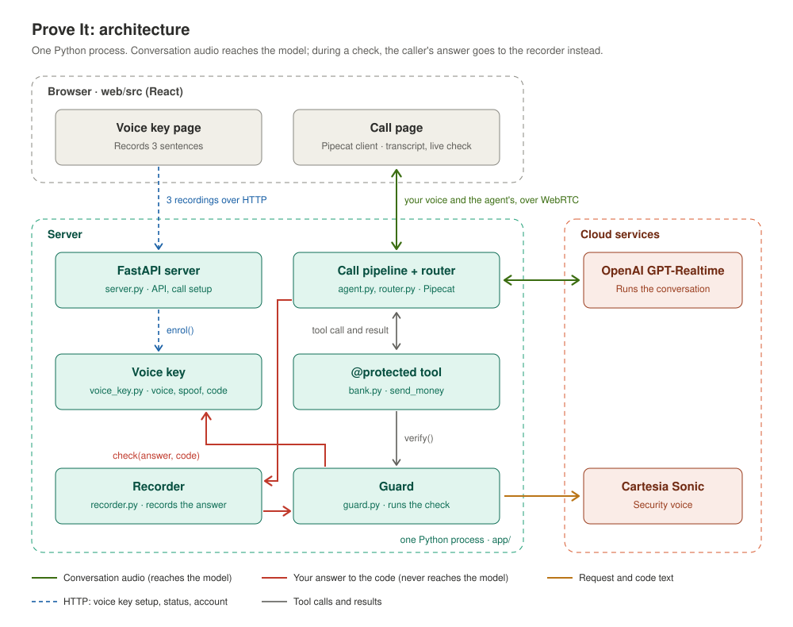

# Prove It

A voice agent whose sensitive tools check your voice before they run.

**Track: Security.** The bank in this demo is invented, and all accounts and money are made up.

- **[ai.md](ai.md):** how AI was used to build this.

## Problem

Voice agents are moving from answering questions to taking actions: paying people, changing account details, resetting access. They're being put on phone lines because a call is the one channel everyone has, including people who are driving, cooking or can't easily use a screen.

On a call there's no screen to tap and no keyboard for a password. The caller's voice is the only thing on the line, so it has to carry the proof.

- **A voice is easy to copy.** A few seconds of someone's audio is enough to clone it.
- **An AI agent is easy to talk round.** An LLM can be persuaded by urgency, a claim to be staff, or a carefully worded request.

So a voice agent that can move money is exposed on both sides. The voice might not be the account holder, and the model deciding whether to act can be manipulated. Telling the model to "verify the caller" doesn't work, because the model is the thing being attacked.

## Solution

You can chat freely and ask your balance. When you ask to send money, a security check runs **inside that tool call**, and the money moves only if all three parts pass:

| Check | Stops | Done by | Passes when |
|---|---|---|---|
| **Your voice:** matches your voice key | Someone else calling as you | SpeechBrain ECAPA-TDNN voiceprints, cosine similarity | ≥ 0.35 |
| **A real voice:** not synthetic | A cloned or text-to-speech voice | DF Arena 500M spoof detector | < 0.50 |
| **Live:** says a fresh code | Replaying an old recording | faster-whisper transcript, digits compared | Exact match |

Each check alone can be beaten. Together they cover replay, cloning and a live impostor.

**Currently, only one tool is protected:** `send_money`. Checking the balance and recent payments need no check, to keep the demo focused on the high-risk action. Protecting another tool takes one `@protected` line.

The check is code, not a prompt. The model can only *ask* for a tool, so persuasion can't skip it. During the check:
- the model is cut off from your audio
- a separate security voice reads back what you're approving ("You asked to send £40.00 to Sam Patel"), then the code.

The model never sees the code, never hears your answer, and learns only whether it passed, never which check failed.

## How to run

You need [uv](https://docs.astral.sh/uv/), Node 20 or later, and Chrome.

1. Copy `.env.example` to `.env` and add your keys:

   | Key | For |
   |---|---|
   | `OPENAI_API_KEY` | The conversation, through GPT-Realtime |
   | `CARTESIA_API_KEY`, `CARTESIA_VOICE_ID` | The security voice that reads the code |

2. Start it. This installs dependencies on first run, then starts the API on port 8000 and the page on port 5180:

   ```bash
   ./run.sh
   ```

3. Open <http://127.0.0.1:5180> in Chrome. The voice models take about 15 seconds to load. The first run downloads about 2 GB of models.

**Try it:**
1. Under **Voice key**, record the three sentences and save. Use the same mic you'll call with. Setting your own key is a demo feature: a real deployment would require sign-in and second-device approval.
2. Start a call and ask "What's my balance?". No check runs.
3. Say "Send Sam forty pounds". After the beep, say the phrase the security voice gives you, and watch the security check panel.
4. Ask someone else to try step 3. **Voice matches key** should fail.

**Tests:**

```bash
uv run pytest
```

```bash
uv run pytest -m slow
```

- **The first command runs 22 fast tests with stand-ins.** They cover protected tools only running after a pass, the caller hearing the real request, the model being cut off while the answer is recorded, audio always coming back, a new code every time, and the model not learning which check failed.
- **The second loads the real models and uses macOS voices.** It checks that the same voice matches, a different voice doesn't, a wrong code fails, and synthetic speech is caught.

## Architecture



### One protected tool call

1. The model asks for `send_money(payee="Sam", amount_pounds=40)`.
2. `@protected` checks the arguments. "Sam" becomes the saved payee "Sam Patel". If anything is wrong, it asks a question instead.
3. The guard **cuts the model off:**
   - the router stops passing your audio to the model
   - the model's input is paused, and its buffer is cleared.
4. The security voice reads back the request and a new 4-digit code, then beeps.
5. The recorder captures your answer until you stop speaking.
6. `VoiceKey.check` runs the three checks.
7. **The audio is always given back** to the model, pass or fail.
8. **Pass:** the tool's body runs and the money moves. **Fail:** nothing changes, and the model is told only `not_verified`.

### Code tour

| File | Lines | What it does |
|---|---|---|
| [app/bank.py](app/bank.py) | 153 | The invented account, the tools as plain functions, and `@protected`: check the arguments, run the guard, then run the tool. Securing a new tool takes one decorator. |
| [app/guard.py](app/guard.py) | 163 | The security check inside a tool call, including the security voice. |
| [app/router.py](app/router.py) | 94 | The gate: passes the caller's audio to the model, or holds it back during a check. |
| [app/recorder.py](app/recorder.py) | 142 | Records the caller's answer and decides when they've finished speaking. |
| [app/voice_key.py](app/voice_key.py) | 250 | Loads the three models. `enrol()` makes the key, and `check()` scores an answer. |
| [app/agent.py](app/agent.py) | 166 | The Pipecat pipeline for one call, and the agent's instructions |
| [app/server.py](app/server.py) | 126 | FastAPI: status, account, voice key, and WebRTC call setup |
| [app/digits.py](app/digits.py) | 25 | Turns "four seven one nine" or "4, 7, 1, 9" into "4719" |
| [app/config.py](app/config.py) | 53 | Settings, limits and pinned model versions |
| [web/src/](web/src/) | 519 | One page: voice key, call with transcript and security check, account |

### Design choices

- **The check lives inside the tool, not in the prompt.** A prompt injection can't talk its way past code.
- **A separate voice reads the code.** Cartesia speaks it with `append_to_context=False`, so the code never enters the model's context.
- **The caller hears what they're approving,** read back from the real arguments. If the model got the amount or payee wrong, the caller can refuse.
- **The server sits in the middle of the audio,** so it, not the browser, decides what the model hears.
- **It fails closed.** Any error means "not verified", and a `finally` block always gives the audio back.
- **One process.** Pipecat and the voice models install into one environment, so there's no plumbing between services.

### What's next: tiered authentication

I'd like to make security tiered, matching how risky each action is:

1. **Session authentication, once per call.** A voice check at the start of the call unlocks account access: the balance, recent payments, the list of payees, adding a payee, and so on.
2. **Step-up check for each high-risk action.** Payments still run the full three-part check every time, even within an authenticated session.

`@protected` would take a level, for example `@protected(level="session")` or `@protected(level="step_up")`, so each tool declares how much proof it needs.

### Limits

- **Thresholds are starting points.** They haven't been tuned on many real voices, and the spoof detector's false-reject rate on real people is unknown.
- **The demo's voice key setup** needs no sign-in, and uses the same three sentences for everyone.
- **The bank is in memory** and resets on restart. The voice key persists in `data/`.
- **DF Arena 500M has a non-commercial licence.** That's fine for a demo, not for a product.
- **It proves who is speaking,** not that they're acting freely. A coached victim still passes.
